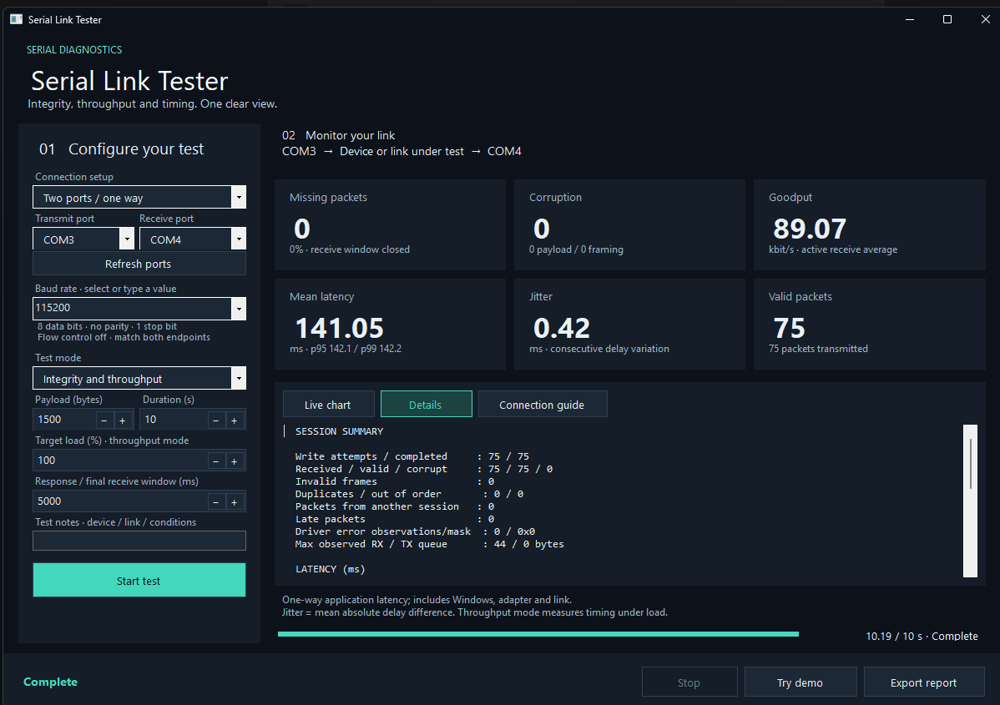

# Serial Link Tester — Windows GUI for Serial Integrity, Throughput & Latency

A free, open-source Windows GUI for testing serial devices and links. Generate
known binary traffic, detect missing or corrupted packets, and measure goodput,
latency and jitter from a dark native desktop interface. Run one-way, simultaneous
bidirectional or round-trip loopback tests — no terminal commands required.


## Screenshot



Earlier v1.1 one-way interface. The current release adds simultaneous bidirectional
results and a separate named serial-warning strip. Values shown are an example
measurement, not a guaranteed hardware performance specification.

## Use Cases

- **Serial link verification** — check a transparent binary path for loss and corruption.
- **Bidirectional stress testing** — run A → B and B → A together with independent results.
- **Latency and jitter analysis** — compare delays under light probing and sustained load.
- **Adapter and cable checks** — compare a direct connection with the complete device path.
- **Repeatable bench reports** — save settings and packet results as HTML, CSV and JSON.

## Features

- **Three setups** — two-port one-way, two-port bidirectional and one-port external loopback.
- **Configurable traffic** — listed/custom baud, 1–2048-byte payload, duration and target load.
- **Independent directions** — separate packet sequences, loss, corruption and timing results.
- **Live charts** — select a direction and switch between latency and goodput.
- **Named warnings** — Framing, Break, Overrun, RX overflow and Parity shown separately from test-stopping errors.
- **Reports** — comparison HTML, direction-tagged CSV, JSON and individual direction reports.
- **Demo mode** — explore simulated results without opening a physical COM port.
- **Portable** — English dark interface and embedded icon; no application installation required.

## Installation

Download from the [Releases page](https://github.com/galenthas/serial-link-tester/releases/latest):

- **`SerialLinkTester.exe`** — portable executable.
- **`SerialLinkTester_vX.Y.Z_Windows.zip`** — executable, English guides, license and SHA-256 manifest.

Requires Windows 10/11, .NET Framework 4.x and the serial adapter's Windows driver.
Close other applications using the selected ports. Open **Try demo** to explore
the interface without connected devices.

## Quick Start

1. Connect two serial ports to the same PC and select **Refresh ports**.
2. Leave **Two ports / bidirectional** selected, then choose distinct **Port A** and **Port B**.
3. Connect both TX/RX paths through the device or link. It must support simultaneous traffic.
4. Match the baud rate at both ends. The app uses **8N1, flow control off**.
5. Start with **Latency and jitter**. Defaults are a 64-byte payload, 60 seconds and a **1000 ms** final receive window.
6. Use **Integrity and throughput** for sustained traffic. Target load applies to **each direction**.
7. Select A → B or B → A for detailed cards and charts; export after the receive windows close.

For a one-way test select **Two ports / one way**. For round-trip testing use a
suitable external serial loopback and **One port / round trip**. See the bundled
[User guide](docs/USER_GUIDE.html) and [Quick start](docs/QUICK_START.txt).

## How It Works

Each packet has a run ID, sequence number, deterministic payload and separate
header/payload CRC checks. COBS framing allows recovery after damaged bytes.
Native overlapped Windows reads and writes run independently of the GUI, while
a high-resolution timer paces outgoing traffic when supported.

Both directions use the same PC clock. Timing includes Windows scheduling,
USB/adapter buffers, UART serialization and the link under test. The application
does not supply hardware timestamps, synchronize separate PCs or measure raw BER.
See [Measurement definitions](docs/MEASUREMENTS.md) for exact calculations and limits.

## FAQ

### Why is goodput lower than baud rate?

Goodput counts verified payload only. With 8N1, eight data bits require ten line
bits, so 115200 baud allows at most 92.16 kbit/s of byte data. Test framing reduces
this further; a 1500-byte payload has an ideal goodput around 89.3–89.6 kbit/s.

### Does a Framing or Break warning stop the test?

No. Amber serial warnings record the types observed during the run. They remain
in the history after reconnecting a cable and reset for each new test. Red
test-stopping errors, such as a failed read or write, are reported separately.

### Does bidirectional 100% load mean 50% in each direction?

No. It requests full target load in each direction independently. Both the wiring
and the tested link must support simultaneous traffic. The app does not arbitrate
a half-duplex bus or provide manual two-wire RS-485 direction control.

### Is latency the delay of the link alone?

It is application-to-application packet delay, including the host, adapters and
serialization. Larger payloads take longer to finish arriving. Round-trip results
cannot establish one-way delay by simply dividing by two.

## Build

Run from PowerShell on Windows. The scripts use the installed .NET Framework
compiler; no Visual Studio, NuGet packages or external icon tools are required.

```powershell
# Compile the application and test executable.
.\scripts\build.ps1

# Run the tests against the build selected by version.json.
$build = & .\scripts\build-config.ps1
& (Join-Path $build.Verification 'CoreTests.exe') (Join-Path $build.Verification 'test_report')

# Build, run tests, create the portable ZIP and verify its hashes.
.\scripts\package.ps1
```

Outputs are written under `artifacts/`. CI runs 30 automated tests covering packet
integrity, accounting, concurrency, shutdown, warnings, failures and reports.
The transport tests use simulations; they do not validate physical hardware timing
or cable disconnect/reconnect behavior.

## Project Structure

| Path | Description |
|---|---|
| `scripts/src/MainForm.cs`, `Theme.cs` | WinForms interface and dark controls |
| `scripts/src/Protocol.cs` | Packet generation, COBS and CRC checks |
| `scripts/src/NativeSerial.cs` | Native Windows serial I/O and cancellation |
| `scripts/src/Engine.cs`, `Session.cs` | Traffic workers and shared-port ownership |
| `scripts/src/Measurement.cs`, `SerialWarnings.cs` | Metrics and named serial warnings |
| `scripts/src/Export*.cs` | HTML, CSV and JSON exports |
| `scripts/assets/`, `scripts/artwork/` | Icon assets and reproducible artwork generator |
| `tests/CoreTests.cs` | Automated protocol and transport tests |
| `version.json` | Release version and date |
| `.github/workflows/test.yml` | Windows tests and tag-triggered releases |

## Versioning

Update `version.json`, the changelog and `docs/releases/vX.Y.Z.md`, then tag the
matching commit:

```powershell
git tag v1.3.0
git push origin v1.3.0
```

CI checks that the tag matches the version, builds and tests the application,
then publishes the portable executable, ZIP, manifest and checksums.
An existing version tag can also be published from **Actions → Tests → Run workflow**
by entering that tag in `release_tag`; an empty value runs tests without publishing.

## License

[MIT](LICENSE).
